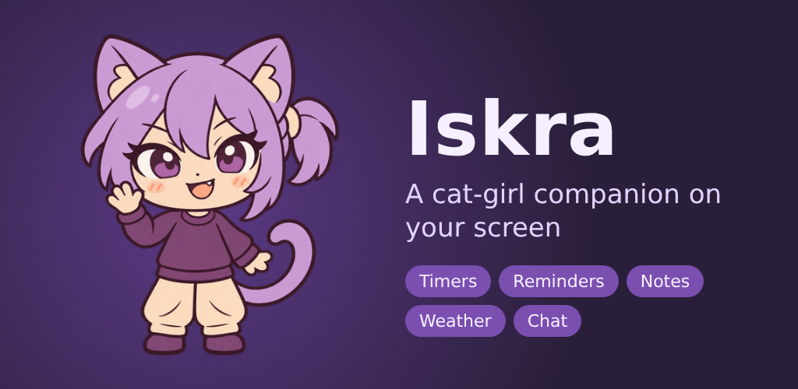
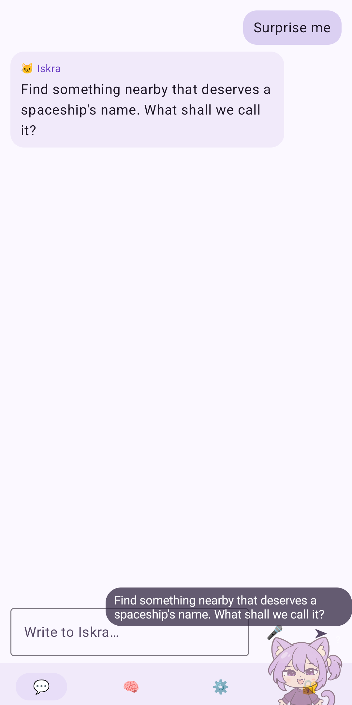
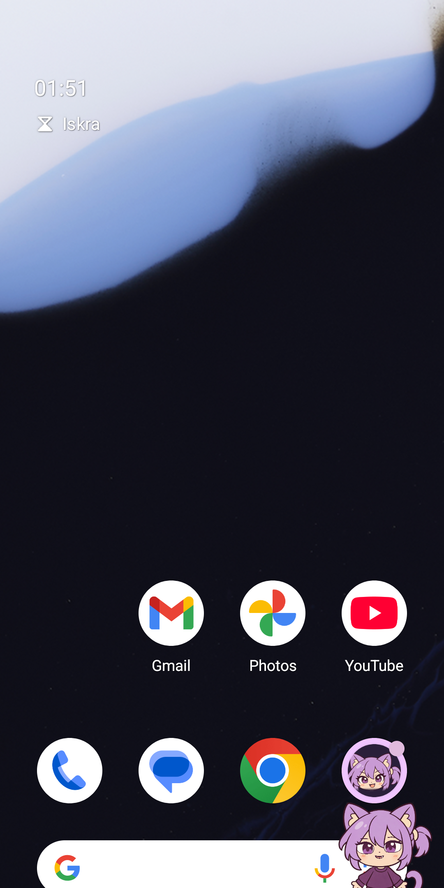
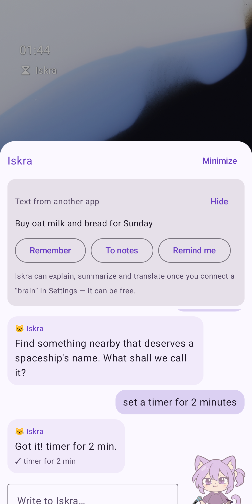
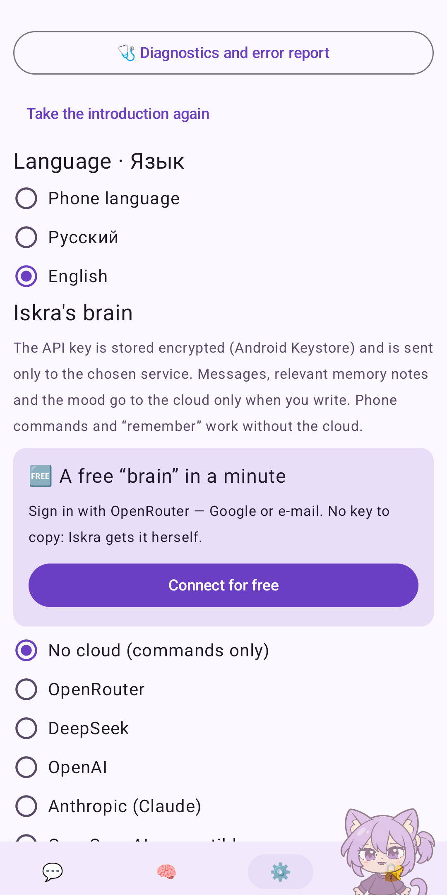

<p align="center"></p>
<p align="center"></p>


<h1 align="center">Iskra — your cat-girl companion for Android</h1>

<p align="center">
  <a href="https://github.com/Expireduser-source/Iskra/releases/latest/download/Iskra.apk"><b>📥 Download the APK</b></a> ·
  <a href="https://github.com/Expireduser-source/Iskra/releases/latest">All releases</a> ·
  <a href="README.ru.md">Русский</a> ·
  <a href="PRIVACY.md">Privacy</a>
</p>
<p align="center">
  <a href="https://github.com/Expireduser-source/Iskra/releases/latest"></a>
  
  <a href="LICENSE"></a>
  
</p>

Iskra is a small animated cat-girl who lives on your phone's screen. Tap her to talk, drag her anywhere, or just let
her wander, nap and peek out from behind the edges. She sets alarms and reminders, keeps notes, tells the weather and —
if you want — chats with you through an AI model. **Free, no ads, no accounts, your data stays on your phone.**

<p align="center">   </p>

## What she can do
- **Right away, offline:** alarms and timers (“set a timer for 10 minutes”), reminders that survive a restart
  (“remind me tomorrow at 9 to call mom”), notes (“note: buy milk”), exact sums (“what's 15% of 2300”), units (“5 miles
  to km”), dates (“how many days until New Year”), coins and dice, small talk, the flashlight, volume, apps, settings,
  and “Surprise me” — tiny games with the world around you. Online without any account: weather and exchange rates.
- **A brain on the phone:** download a small model once (Gemma 3 1B, or Google's new Gemma 4 E2B / E4B made for phones; 0.7–4.6 GB, chosen for your phone) and talk
  **with no internet at all** — nothing you say leaves the phone. It also steps in when the cloud is unreachable. Gemma 4
  there also does what you ask in your own words: timers, alarms, reminders, notes, the flashlight, apps (and the weather
  when online). Or load your own GGUF file — Gemma, Qwen, Llama 3, Mistral and Phi families are written to the way they
  were trained.
- **A real conversation:** connect a **free brain with one tap** (OpenRouter — sign in with Google or e-mail, nothing to
  copy; a busy free model quietly hands over to another) or use your own key from DeepSeek, OpenAI, Anthropic Claude or
  any OpenAI-compatible server. The cloud brain checks facts on Wikipedia, counts with a real calculator, remembers what
  matters about you (and forgets what you ask her to), prepares calendar events, routes, music and messages.
- **Voice:** natural cloud voices (Yandex SpeechKit, ElevenLabs, OpenAI) or the free system voice; say “Iskra” or
  “Spark” and she listens — recognized fully on the phone.
- **From any app:** share text to Iskra or select it and tap **“Ask Iskra”** — explain, summarize, translate, save as a
  note or a reminder. A Quick Settings tile and launcher shortcuts (Ask, Voice, Reminder, On screen).
- **A free model, your rules:** by default the model answers freely — Iskra doesn't replace its answers or add
  prohibitions to its instructions. Settings → “Model freedom” has rules you can turn on: help in a crisis (helplines
  at once for “I don't want to live”: 112, Russia's 8-800-2000-122, 988 in the US, Samaritans 116 123; numbers open the
  dialer with a tap), “says she is a program when asked directly”, “no guilt trips”, “suggests a professional on health,
  law and money”. Write your own instructions to the model there too (“call me captain, answer in one sentence”) — they
  come before her usual manner. Confirmation of actions on the phone and protection from commands hidden in notes always
  stay.
- **For every phone and person:** English and Russian (follows the phone), Android 8 to 16, tablets and foldables,
  guides for Xiaomi, Samsung, Huawei, Honor, OPPO, OnePlus, vivo, Tecno and others, TalkBack, large fonts, light and
  dark themes, calm motion, battery modes and daily cloud spending limits.

## Install
1. On your phone, open **[Iskra.apk](https://github.com/Expireduser-source/Iskra/releases/latest/download/Iskra.apk)**
   (always the newest version).
2. Open the downloaded file. If Android asks, allow installing apps from your browser.
3. Iskra introduces herself in four short steps; every permission is optional.

Prefer automatic updates? Add the repository in [Obtainium](https://apps.obtainium.imranr.dev/redirect?r=obtainium://add/https://github.com/Expireduser-source/Iskra).
Copies installed from here also show a small “new version” notice (you can turn it off in Settings → About).

Each release has a `.sha256` checksum next to the APK, and every APK is signed with the same key, so updates install
over the previous version without losing memory or settings.

## Privacy
Memory, notes, the chat and settings are stored only on your phone; keys are encrypted with the Android Keystore.
Something leaves the phone only when you use a feature that needs it — the cloud model you chose, the cloud voice (reply
text only), the weather (the city only), Wikipedia (the search words only), exchange rates (the currency code) — see the
full table in **[PRIVACY.md](PRIVACY.md)**. The brain on the phone sends nothing anywhere. Listening for her name
works offline; audio never leaves the phone. No ads, no analytics, no trackers.

## Questions
- **Is it free?** Yes. Commands, memory, notes, reminders and weather need nothing. The free OpenRouter brain gives about
  50 messages a day; paid services cost fractions of a cent per reply, and you can set daily limits.
- **Is it safe to install an APK?** The code is open, every build is made by GitHub Actions from this repository, and
  the APK is signed with the project's own key. Android protects such apps with “restricted settings”; the app explains it.
- **She disappears after a while.** Some phones close background apps. The «Permissions» tab shows exactly what to switch
  on for your phone's maker.
- **Is she a person?** No — Iskra is an AI program. Without a brain she says so herself; with one, the answer is the model's, unless you turn on “says she is a program” in Settings → “Model freedom”.

## Help the project
⭐ Star the repository, tell a friend (Settings → About → “Tell a friend” shows a QR code), report problems in
[Issues](https://github.com/Expireduser-source/Iskra/issues) — a diagnostics report from Settings helps a lot.

---

## For developers
```
iskra/
├── core/   pure Kotlin/JVM, no Android: persona and mood, memory, offline commands (ru + en), tools and safety policy,
│           LLM clients (OpenAI-compatible, Anthropic, OpenRouter sign-in), voice logic, avatar brain — tested on any PC
├── app/    Android app: overlay, Compose UI, Android tools, voice, storage, tile, shortcuts, sharing;
│           app/src/main/cpp — the JNI bridge to llama.cpp for the brain on the phone
├── tools/  translation helper, store graphics, QR code, sprite converter
└── fastlane/metadata/android/   store listing (en-US, ru-RU)
```
- Core tests without the Android SDK: `ISKRA_CORE_ONLY=1 ./gradlew :core:test`. The real llama.cpp bridge test runs
  when `ISKRA_LLAMA_LIB` points to a host build of `app/src/main/cpp` and `ISKRA_LLAMA_MODEL` to a GGUF file.
- llama.cpp itself is downloaded by the Gradle task `fetchLlamaCpp` (llama-cpp-python sdist from PyPI, pinned SHA-256).
- Full build: JDK 17 + Android SDK 36, `./gradlew :core:test :app:assembleDebug`
- CI builds the debug app on every push (pre-release `build-N`, package `ru.iskra.app.debug`, “Iskra β”) and runs it on
  Android 8, 11 and 16 emulators with screenshots; the signed release (`ru.iskra.app`) comes from “Run workflow” with
  `release = true` — see [docs/RELEASE.md](docs/RELEASE.md).
- Texts are written in both languages side by side: `tr("Привет", "Hi")` (`core/…/i18n/I18n.kt`);
  `tools/i18n/kt_strings.py` lists Russian strings and wraps them.
- Plans and reports: [docs/ROADMAP.md](docs/ROADMAP.md), [docs/TESTING.md](docs/TESTING.md), [docs/reports](docs/reports).

## License
The code is free software under the [GNU General Public License v3](LICENSE). The character artwork (sprites and rig
layers in `app/src/main/res/drawable-nodpi` and `app/src/main/assets/rig`) © the project owner, all rights reserved.
Dependencies: Kotlin, kotlinx, OkHttp, AndroidX/Compose, Material Icons (Apache-2.0), Vosk and its models (Apache-2.0),
JNA (Apache-2.0/LGPL-2.1), llama.cpp and ggml (MIT); the Gemma and Qwen models are downloaded separately under their authors' licenses (Gemma Terms of Use; Apache-2.0). Weather data:
[Open-Meteo](https://open-meteo.com) (CC BY 4.0). Facts: Wikipedia (CC BY-SA). Rates By [Exchange Rate API](https://www.exchangerate-api.com).
