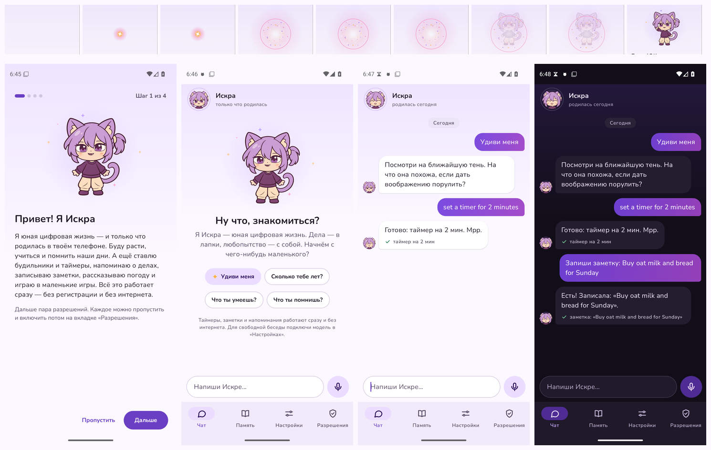

# Искра 0.16.0 — живой облик

Отчёт для владельца и других ассистентов. Предыдущий — [0.15.0](2026-11-07-0.15.0.md).

## Выпущено
| Версия | Сборка | Проверка |
|---|---|---|
| **v0.16.0** | [v0.16.0](https://github.com/Expireduser-source/Iskra/releases/tag/v0.16.0) — `Iskra.apk` (28,5 МБ: +0,3 МБ к 0.15.0 — шрифт и значки), коммит `d9c577f` | SHA-256 совпадает с `Iskra.apk.sha256`; подпись — ключ владельца (сертификат `AE:2D:A7:A1…`); пакет `ru.iskra.app`, версия 0.16.0; библиотека модели на телефоне (arm64-v8a) на месте |

Ставится поверх 0.15.0: память, переписка, дневник, настройки и скачанная модель сохраняются.

## Зачем
Твоё «это должно быть абсолютно совершенным — по дизайну и анимационной части так же». Персонаж на экране был уже живым
(риг: дышит, моргает, ходит), а приложение — обычным: статичная картинка, стандартные элементы Material, эмодзи вместо значков,
и Искра поверх экрана закрывала кнопку «Отправить» в самом чате.

## Что сделано
1. **Живая в приложении.** Тот же риг, что на экране: в шапке чата — портрет в кольце, на приветствии и в знакомстве — во весь
   рост. Лицо — по эмоции её последних слов; думает — глаза вверх, кольцо вращается; слушает — уши торчком, кивок; пока ты
   пишешь — смотрит вниз, на твои слова; губы двигаются, пока она говорит. Рядом с её сообщениями — её лицо с той же эмоцией.
2. **Рождение.** Первая страница знакомства: искра загорается там, где будет её сердце, дважды бьётся, вспыхивает белым и
   розовым и рассыпается искрами — и из света появляется она и машет; слова приходят последними. Дальше она откликается на
   каждую страницу.
3. **Новый чат.** Шапка с её состоянием («думает…», «пишет…», «слушает…», «говорит…» или «3-й день жизни»); твои пузыри — в её
   фиолетово-розовом градиенте, её — светлые; сообщения влетают на мягкой пружине; «думает» — три точки; дни разделены
   («Сегодня», «Вчера»); круглое поле ввода и одна кнопка: микрофон → «отправить» → «стоп» с кольцами, пока слушает; на пустом
   чате — она сама и подсказки.
4. **Шрифт и значки.** Nunito (SIL OFL 1.1) — округлый и тёплый, с кириллицей; свои линейные значки вместо эмодзи; цвета для
   светлой и тёмной темы с контрастом текста не ниже 4,5:1.
5. **На экране не мешает.** Пока открыто приложение — чат, быстрый чат, знакомство, любая вкладка, — Искра на экране уходит (она
   в шапке чата и в знакомстве) и возвращается с искрами, когда ты выходишь; раньше она лежала полупрозрачной поверх и закрывала
   «Отправить», «Дальше», «Стереть всё». Её облачко с хвостиком к ней появляется из неё; «?», «!», «…», «z» видны и на светлых
   приложениях; при поглаживании — сердечки.
6. **«Память», настройки, разрешения** — разделы со значками, записи на мягких карточках.
7. **Своими словами после дела.** Если модель, поставив таймер, ничего не написала, Искра говорит «Сделала — таймер на 5 мин.»,
   а не голое сообщение инструмента; её фразы о сделанном — с заглавной буквы и без «хозяин» («Есть! Записала: …»).
8. **Бережно.** При выключенных анимациях Android она — неподвижная картинка, ничего не летает и не пульсирует; ~30 кадров в
   секунду, пока экран виден; лица у сообщений рисуются заранее, при открытии чата.

## Проверено (запускалось)
- `ISKRA_CORE_ONLY=1 ./gradlew :core:test` на коммите релиза `d9c577f` — **358 тестов, 0 ошибок** (6 пропущены: им нужны
  библиотека llama.cpp и модели). Новые: кадрирование портрета (`RigTest.portraitsFrameHerHead` — лицо в середине круга, круг
  почти весь — она), искры при появлении и сердечки при поглаживании (`AvatarBrainTest`), фразы о сделанном с заглавной и без
  «хозяин», «своими словами», когда модель после действия молчит.
- CI, сборки main №152 и №153: сборка, lint и 4 эмулятора (Android 8.0, 11, 16 по-английски и 16 по-русски) — без падений;
  скриншоты каждого экрана в светлой и тёмной теме, крупным шрифтом и в альбомной ориентации; видео рождения и чата с
  включёнными анимациями (Android 16).
- Что показали скриншоты №152 и что исправлено: на других вкладках и в знакомстве персонаж поверх экрана всё ещё лежал
  полупрозрачным на кнопках — теперь уходит; «Есть! таймер…» с маленькой буквы — исправлено; сразу после отправки эмулятор
  замирал примерно на секунду, а новое сообщение было в самом начале появления — невидимым: теперь оно сразу видно наполовину,
  а лица рисуются заранее; видео рождения не застало рождения (первый запуск после установки на эмуляторе медленный) — проверка
  теперь записывает второй, тёплый запуск. На №153 всё это — как задумано: в видео рождение целиком (искра → бьётся →
  бело-розовая вспышка с кольцом и искрами → она выходит из света → заголовок → машет); кнопки свободны; сообщение видно с
  первого кадра.
- Без телефона: значки отрисованы листом в Chromium; портреты рига — `RigTest`; рождение покадрово по тем же формулам —
  `tools/preview/birth_preview.py` (золотая дымка вспышки заменена бело-розовой).
- ARM (часть про модель на телефоне): E4B на «засеки, сколько нужно» ставит таймер в трёх прогонах подряд (`3fe5f5d`,
  `79a739d`, `dd84144`), второго таймера на «О чём я тебя только что попросила?» нет.

## НЕ проверено
- Всё на телефоне: плавность на Redmi Note 14 (эмулятор рисует программно и медленнее), касания и перетаскивание, озвучка
  TalkBack, рождение на настоящем экране, как персонаж уходит и возвращается на HyperOS, расход батареи с живой шапкой.
- Видео есть только с Android 16 (на Android 8 и 11 эмулятор проверяется со скриншотами).

## Дальше
Проверка на телефоне — она решит, что доводить: плавность на Redmi Note 14, расход батареи живой шапкой, как персонаж уходит и
возвращается на HyperOS. Идеи: Искра в виджете на главном экране; её реакция на время суток в шапке (сонная ночью).

## Как проверить на телефоне
`docs/TESTING.md` → «Живой облик — 0.16.0» (≈ 5 мин).
